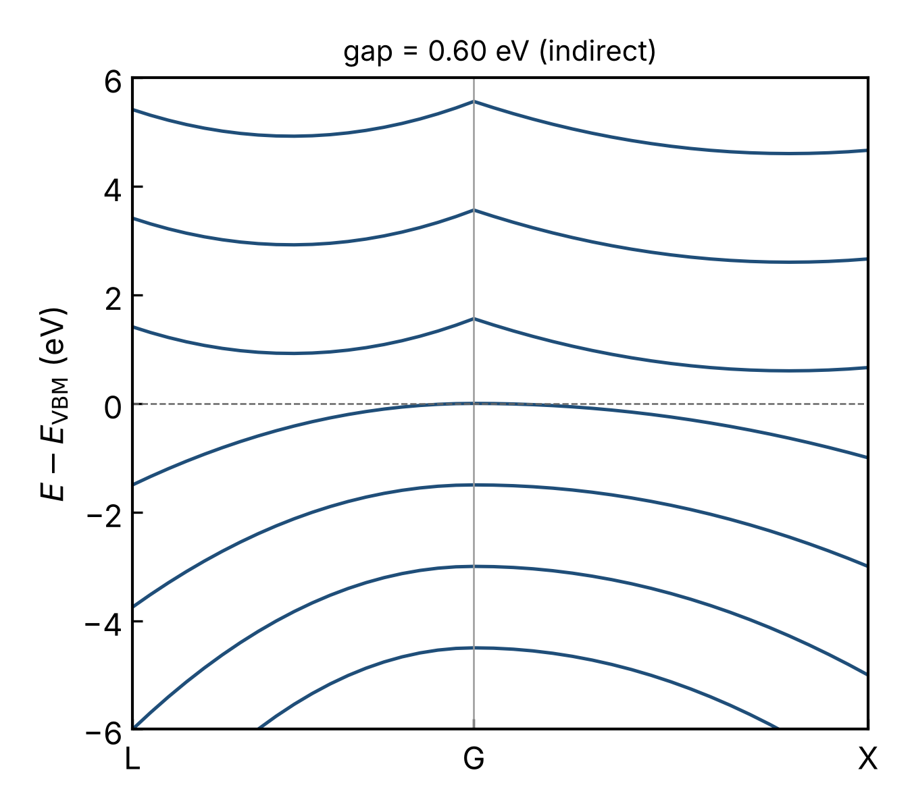
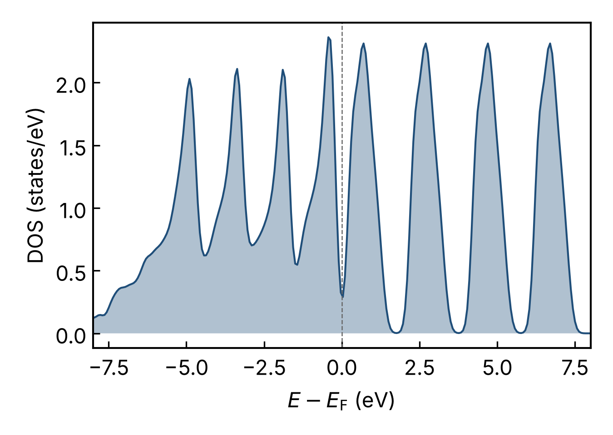

# vasp-postkit

Single-file post-processing for VASP calculations. No pymatgen or ASE needed:
only `numpy` and `matplotlib`.

```bash
python vasppost.py summary <calc_dir>                     # JSON: energy, forces, gap
python vasppost.py bands   <calc_dir> -o bands.png --labels L,G,X
python vasppost.py dos     <calc_dir> -o dos.png
python vasppost.py relax   <calc_dir> -o relax.png
```

## What it reads

| File | Extracted |
|---|---|
| `OUTCAR` | free energy per ionic step, forces, Fermi level, ion count, convergence flag |
| `EIGENVAL` | k-points, eigenvalues, occupations (ISPIN = 1 or 2) |
| `DOSCAR` | total and integrated DOS |
| `POSCAR` / `CONTCAR` | lattice, used to measure the k-path in 1/Å |

## Band-gap logic

Occupied states are taken from the occupations in `EIGENVAL`; if the file has
none, from the Fermi level; if that is missing too, from the electron count.
A band that is filled at some k-points and empty at others marks the system
as a metal. The fundamental gap, the smallest direct gap and the k-points of
the band edges are reported. The gap is only as good as the k-mesh: a
band-structure path can miss the true band edges.

## Example

`python make_fixtures.py` writes a **synthetic** calculation directory whose
model band structure has an exactly known gap (0.60 eV indirect, 0.985 eV
direct). The figures below come from it; they are format demonstrations, not
DFT results.

 

## Tests

```bash
pytest -q        # 9 tests
```

The tests check round-trip parsing, the known gaps, metal detection,
spin-polarised input, DOS normalisation (integrates to the electron count)
and k-path lengths against the analytic reciprocal lattice.

## Related tools

Mature packages already cover this ground and do far more: `py4vasp` (official),
`sumo`, `PyProcar`, `vaspvis`, `pymatgen` and the `vaspkit` binary. This project
is a deliberately small, dependency-light implementation written to show the
parsing and band-edge logic end to end; for production work use one of those.

## Known limits

- Validated on synthetic files in VASP's layout, not yet on a range of real
  outputs and VASP versions.
- No projected DOS, no hybrid-functional `EIGENVAL` with weighted + zero-weight
  k-points handled specially, no non-collinear spin.
