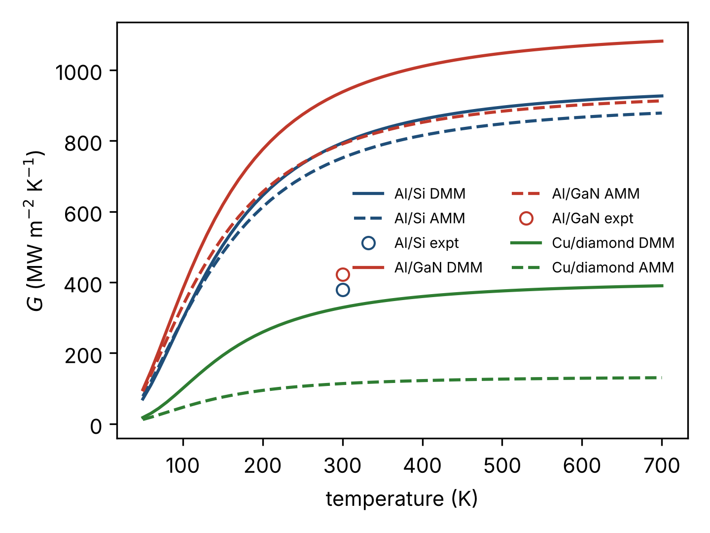

# tbc-toolkit

Tools for predicting thermal boundary conductance (TBC) at solid–solid
interfaces, starting from the Al(111)/Si(111) interface.

| File | Purpose | Status |
|---|---|---|
| `mismatch.py` | Acoustic and diffuse mismatch models (Debye) | computed, tested |
| `build_interface.py` | Al(111)/Si(111) supercell → LAMMPS data file | tested (geometry) |
| `nemd_post.py` | NEMD output → flux, temperature jump, G ± error | tested on synthetic output |
| `in.nemd.lammps` | NEMD protocol (minimise, equilibrate, steady state, production) | smoke-tested |
| `run_nemd.py` | One-command driver for the whole workflow | smoke-tested |
| `compare.py` | Table and plot of finished runs against AMM/DMM and experiment | tested |

## 1. Classical baselines

```bash
python mismatch.py --plot amm_dmm_baseline.png
```

Computed with this code (MW m⁻² K⁻¹), measured values as quoted from
Li et al., Nat. Commun. 13, 4901 (2022):

| Interface | T (K) | DMM | AMM | Measured |
|---|---|---|---|---|
| Al/Si | 300 | 794 | 752 | ≈379 |
| Al/GaN | 300 | 938 | 791 | ≈423 |
| Cu/diamond | 300 | 329 | 114 | – |

Both Debye-based models overestimate the two measured interfaces by roughly a
factor of two, and both saturate above about 500 K, whereas the measurements
are reported to keep rising. The absolute values are sensitive to model
conventions: counting Si phonon states per primitive cell instead of per atom
lowers the Al/Si DMM value from 794 to 680. Full-dispersion DMM variants in
the literature give different numbers again. Treat these as *this
implementation's* baselines.

Checks in the test suite: analytic high-temperature limit for identical solids
(`G = k_B n Σv / 8` for DMM, `/4` for AMM), detailed balance (`G_ab = G_ba`),
`T³` law at low temperature, and grid convergence.



## 2. Interface structure

```bash
python build_interface.py --si-bilayers 40 --al-layers 60 -o alsi.data
```

4×4 Al(111) on 3×3 Si(111) in an orthorhombic cell, Al strained +0.59 %
in-plane. The default gives 3,360 atoms, a 229.9 Ų cross-section and a
273 Å long cell. The Si slab is cut between bilayers (one dangling bond per
surface atom). The 2.4 Å interface separation and the lateral registry are
starting guesses and must be relaxed.

## 3. NEMD and analysis

```bash
python run_nemd.py --preset smoke            # a few minutes: does everything run?
python run_nemd.py --preset quick -T 300     # hours: first usable value
python run_nemd.py --preset full  -T 300     # production length
```

`run_nemd.py` builds the interface, writes the potential file, runs LAMMPS and
extracts `G = J / ΔT`, with `J` from the thermostat energy slopes and `ΔT` from
linear fits on each side extrapolated to the interface. The error bar is a
block average over time. The analysis recovers a planted value of
379 MW m⁻² K⁻¹ from synthetic LAMMPS-format output to within 3 %.

| Preset | Atoms | MD steps | Purpose |
|---|---|---|---|
| smoke | 1,008 | 3,000 | pipeline check only; the number is meaningless |
| quick | 2,520 | 500,000 | first estimate |
| full | 3,360 | 2,700,000 | production |

Default potential: the Al–Si–Mg–Cu–Fe 2NN-MEAM set shipped with LAMMPS
(Jelinek et al., Phys. Rev. B 85, 245102 (2012)). Another potential can be
supplied with `--potential-file my_potential.lmp`.

The smoke preset has been run end to end with LAMMPS (MEAM, single core:
about 52,000 atom-steps per second, one minute in total). Production values
are still to come. Add `--np N` to run on N MPI processes.

### Installing LAMMPS

- Ubuntu / Debian / Google Colab: `apt-get install -y lammps`
- conda (Linux, macOS): `conda install -c conda-forge lammps`

The MEAM package must be included in the build (`lmp -h | grep meam`). The
potential files `library.meam` and `AlSiMgCuFe.meam` are looked for in the
LAMMPS potentials directory; if they are not found, copy them from the
`potentials/` folder of the LAMMPS source into `03-tbc-toolkit/potentials/`.

## Roadmap

1. Smoke run, then the quick preset with the MEAM potential.
2. Convergence in length and cross-section; pressure-relax the cell at each
   temperature (the walls are currently rigid).
3. Swap in a machine-learned potential and compare against the baselines and
   experiment over 80–700 K.

Things the MD will not capture without extra modelling: electron–phonon
coupling in the metal, quantum statistics below the Debye temperatures
(Si ≈ 640 K), and real interfacial disorder.

## Related work to read first

- Phonon local non-equilibrium at the Al/Si interface from machine-learning MD,
  J. Appl. Phys. 137, 115301 (2025) – a neural-network potential for this exact
  interface.
- Thermal boundary conductance of metal–diamond interfaces predicted by MLIPs,
  arXiv:2404.15465.
- GaN/AlN TBC with moment tensor potentials, arXiv:2503.05084.

## Tests

```bash
pytest -q        # 26 tests
```
