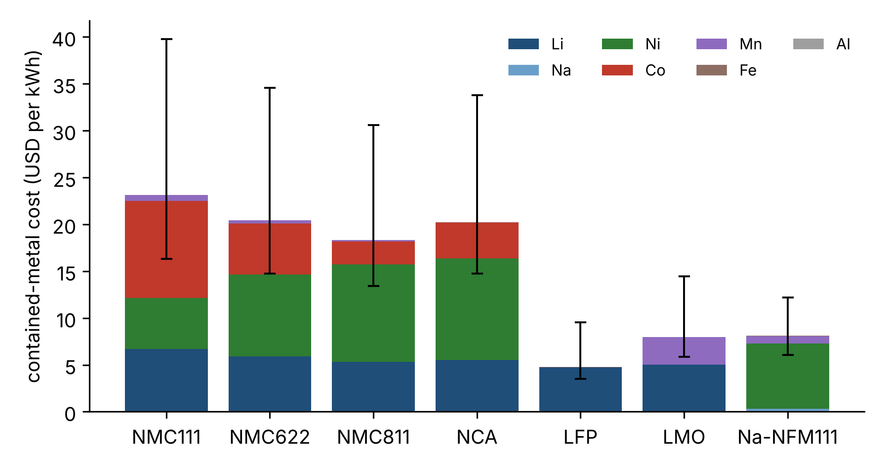

# battery-metals-cost

How much lithium, nickel, cobalt and sodium does a kilowatt-hour of cathode
need, and what does a move in metal prices do to its cost? A small model that
goes from stoichiometry to price exposure.

```bash
python report.py --scenario data/prices_scenario.csv --out report/
```



## Method

For an active material with capacity `Q` (mAh/g) and average cell voltage `V`:

```
kg of cathode per kWh = 1000 / (Q · V)
kg of metal per kWh   = mass fraction of the metal × 1000 / (Q · V)
cost per kWh          = Σ (kg of metal per kWh × price per kg of contained metal)
```

Example, NMC811 (LiNi₀.₈Mn₀.₁Co₀.₁O₂, 200 mAh/g, 3.7 V): 1.35 kg of cathode per
kWh, containing 0.096 kg Li, 0.65 kg Ni, 0.08 kg Co and 0.07 kg Mn.

Because cost is linear in every price, sensitivities and break-even prices are
exact rather than fitted:

- `cost.tornado` moves one metal at a time between its low and high price;
- `cost.breakeven_price` gives the lithium price at which two chemistries cost
  the same, e.g. LFP against a sodium-ion layered oxide;
- `cost.cost_history` turns metal price series into a cost series.

`market.py` adds the market side: a reader for the World Bank "Pink Sheet"
monthly workbook, annualised volatility, maximum drawdown and the
Herfindahl–Hirschman index of supply concentration.

## What the numbers are and are not

- **Intensities are computed**, from formulae and the capacities and voltages
  listed in `chemistry.py`. Those are typical practical values; they shift with
  cut-off voltage and cell design, and are easy to change.
- **The shipped prices are an illustrative scenario, not market data.** The
  table and figure here only demonstrate the model. Replace
  `data/prices_scenario.csv` with dated, sourced prices before quoting results.
- **Contained-metal cost is not cell cost.** It ignores precursor processing,
  yield, the anode, electrolyte, current collectors and manufacturing. It is the
  part of the cost that moves with commodity markets.

## Using real price data

1. Download *Monthly prices (XLS)* from <https://www.worldbank.org/commodities>.
2. `python report.py --pink-sheet CMO-Historical-Data-Monthly.xlsx --since 2015`

The workbook covers nickel, aluminium and copper. Lithium, cobalt and manganese
are not in it and have to come from another source (for example USGS Mineral
Commodity Summaries for annual averages); load them with `market.load_price_csv`.

## Related work

Full process-based cell cost models exist and go much further: Argonne's BatPaC,
the open Excel model CellEst (Fraunhofer FFB), and Wentker, Greenwood and Leker,
*Energies* 12, 504 (2019), which links cathode cost to metal prices. This
repository is a compact, tested Python take on the raw-material slice only.

## Tests

```bash
pytest -q        # 21 tests
```

They check hand-calculated intensities, mass balance, linearity of cost in
price, that the break-even price equalises the two costs, reference values of
the concentration index, and the workbook parser against a file laid out like
the World Bank original.
