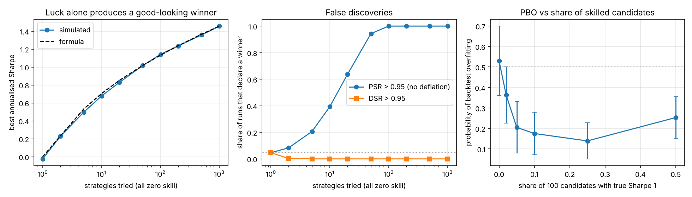
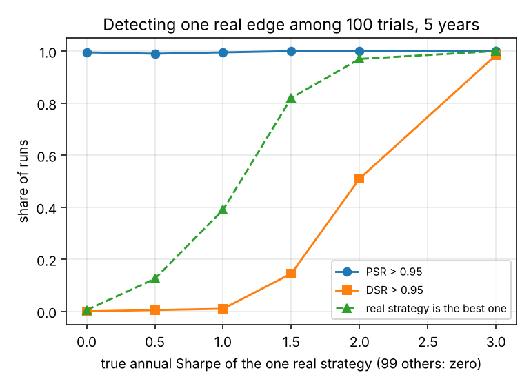

# Backtest overfitting: selection-bias statistics and a simulation study

Pick the best of many strategies and its backtest looks good even when none of
them has any edge. This project implements the standard corrections and then
measures, on synthetic data where the truth is known, how big the problem is
and how well the corrections work.

- `backtest_stats.py`: Sharpe ratio, its standard error with skew and kurtosis,
  probabilistic Sharpe ratio (PSR), expected maximum Sharpe ratio of N null
  strategies, deflated Sharpe ratio (DSR), and probability of backtest
  overfitting by combinatorially symmetric cross-validation (CSCV).
  numpy and scipy only.
- `run_study.py`: the simulation study below (about 40 s on two cores).
- `test_backtest_stats.py`: 18 tests (`pytest`).
- `example_results/`: the figures, JSON and log produced by `run_study.py`.

## What it is and is not

The methods are not new. They come from Bailey and Lopez de Prado (PSR 2012,
DSR 2014) and Bailey, Borwein, Lopez de Prado and Zhu (PBO, 2017), and there
are existing Python implementations (for example `pypbo` and the
`deflated-sharpe` package). This is an independent implementation with tests,
plus a study that checks the formulas numerically. It does not use market
data: every return series is simulated, so nothing here says anything about a
real strategy.

## Setup of the study

Daily returns are independent normal with a standard deviation of 1%, five
years of data (1260 days). Strategies are independent. A strategy with "true
Sharpe 1" has an added daily mean of `1 * sigma / sqrt(252)`.

## Results

**1. Luck alone produces a respectable winner.** Best annualised Sharpe among N
strategies that all have zero skill (300 repetitions per row):

| N tried | best Sharpe, simulated | formula | runs with best Sharpe > 1 |
|---:|---:|---:|---:|
| 1 | -0.02 | 0.00 | 1% |
| 10 | 0.68 | 0.70 | 10% |
| 50 | 1.02 | 1.02 | 49% |
| 100 | 1.14 | 1.13 | 76% |
| 1000 | 1.46 | 1.46 | 100% |

The simulated means follow the expected-maximum formula closely, which checks
`expected_max_sharpe` and `null_max_sharpe_annual` numerically.

**2. Ignoring selection produces false discoveries.** Declaring a winner when
the winner's PSR against zero exceeds 0.95 gives a false-positive rate of 21%
at N = 5, 64% at N = 20, 94% at N = 50 and 100% from N = 100. The deflated
Sharpe ratio at the same threshold flagged essentially none of the null runs
from N = 2 upward (below 1% in 300 runs per row), against a nominal 5% for a
single test.

**3. The correction is conservative.** One real strategy hidden among 99 null
ones, five years of data:

| true Sharpe of the real one | it is the best-looking one | PSR flags a winner | DSR flags a winner |
|---:|---:|---:|---:|
| 0.0 | 1% | 99% | 0% |
| 0.5 | 12% | 99% | 1% |
| 1.0 | 39% | 99% | 1% |
| 1.5 | 82% | 100% | 14% |
| 2.0 | 97% | 100% | 51% |
| 3.0 | 100% | 100% | 98% |

With 100 trials and five years, an edge of Sharpe 1 is mostly invisible to the
deflated test, and Sharpe 2 is detected about half the time. Strategies of
that quality are rare, so this is a statement about how much data a search
over 100 variants needs, not a flaw of the method.

**4. PBO measures rank instability, not the existence of skill.** With 100
candidates and a growing share carrying a real Sharpe of 1 (30 repetitions
each, mean +- sd across repetitions):

| share skilled | PBO | in-sample minus out-of-sample Sharpe of the pick |
|---:|---:|---:|
| 0% | 0.53 +- 0.17 | 1.65 |
| 2% | 0.36 +- 0.14 | 1.45 |
| 5% | 0.20 +- 0.13 | 1.19 |
| 25% | 0.14 +- 0.09 | 1.28 |
| 50% | 0.25 +- 0.10 | 1.51 |

PBO is close to 0.5 for pure noise, as it should be, and drops once some
candidates are genuinely better. It rises again at 50% skilled: when many
candidates are equally good, the in-sample winner among them is a coin flip
for out-of-sample rank, so PBO can be high even though the winner is real.
Read it together with the Sharpe drop, which stays large in every row because
the in-sample best is always partly selected on noise.




## Limits

- Normal, independent returns and independent strategies. Real strategies are
  correlated, which lowers the effective number of trials; DSR with the raw
  trial count is then too harsh. Fat tails and autocorrelation are not
  simulated.
- The variance across trials used for DSR is estimated from the simulated
  cross-section, as in the original paper. With very few trials this
  estimate is noisy.
- PBO uses 16 blocks (12,870 splits). Its sampling spread across repetitions is
  large (see the +- column), so a single PBO estimate should be read loosely.

## Use

```python
import backtest_stats as bs

# returns: array of shape (T, N), one column per candidate strategy
pbo = bs.pbo_cscv(returns, n_blocks=16)["pbo"]
srs = bs.sharpe_ratio(returns)
best = srs.argmax()
dsr = bs.deflated_sharpe(returns[:, best], n_trials=returns.shape[1],
                         sr_var_trials=srs.var(ddof=1))
```

Count every variant you tried, including the ones you discarded, when you set
`n_trials`.
