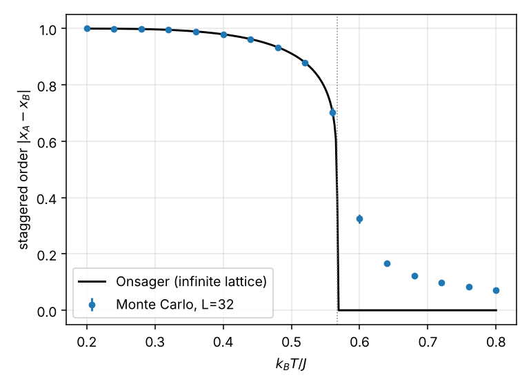
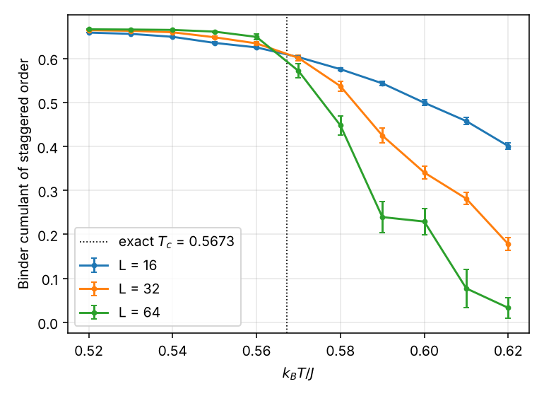
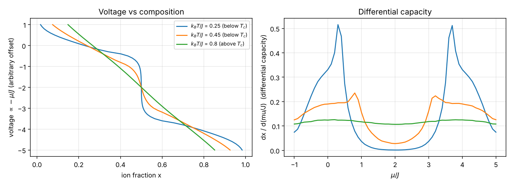

# Lattice-gas Monte Carlo: ion ordering and voltage steps

A small Monte Carlo code for a lattice gas of mobile ions in a host, with a
nearest-neighbour repulsion `J` and a chemical potential `mu`:

    H = J * sum_<ij> n_i n_j - mu * sum_i n_i      (n_i = 0 or 1)

At half filling the ions order into a checkerboard. In an intercalation
electrode this kind of ordering shows up as a voltage step at a rational
composition and as sharp peaks in the differential capacity, so the model is a
minimal picture of why some cathodes have a stepped voltage curve.

- `lgas.py`: the model. Metropolis updates, vectorised over one sublattice at a
  time (the square lattice is bipartite, so the two halves can be updated in
  parallel). Also the exact Onsager result, Binder cumulant and jackknife
  error helpers. numpy only.
- `run_study.py`: validation against exact results and the voltage curves.
- `test_lgas.py`: 13 tests (`pytest`), including a brute-force check of the
  single-flip energy change and of the total energy.
- `example_results/`: figures and JSON written by `run_study.py`.

## What it is and is not

Lattice-gas models of intercalation voltage curves are well established, and
the nearest-neighbour model on the square lattice maps exactly onto the
antiferromagnetic Ising model, so none of this is new. It is a tested
implementation whose output can be checked against exact results. The model is
two-dimensional with one interaction and no connection to a particular
material: energies are in units of `J`, and the voltage axis has an arbitrary
offset.

## Validation

At `mu = 2J` (half filling) the model is an antiferromagnetic Ising model with
coupling `J/4`, and the exact critical temperature is
`k_B T_c / J = 1 / (2 ln(1 + sqrt 2)) = 0.5673`.

**Order parameter.** The staggered order `|x_A - x_B|` from Monte Carlo on a
32 x 32 lattice (3000 equilibration sweeps, 6000 sampled sweeps, jackknife
errors) against the exact infinite-lattice Onsager curve:

| k_B T / J | Monte Carlo | exact |
|---:|---:|---:|
| 0.20 | 1.000 | 1.000 |
| 0.40 | 0.980 | 0.980 |
| 0.48 | 0.934 | 0.934 |
| 0.52 | 0.878 +- 0.002 | 0.879 |
| 0.56 | 0.704 +- 0.016 | 0.707 |

Above `T_c` the exact value is zero but a finite lattice gives a nonzero
`|m|` of order `1/L` (0.325 at 0.60, 0.072 at 0.80 for L = 32); that is a finite-size
effect, not a disagreement.

**Critical temperature from Binder cumulants.** Lattices of 16, 32 and 64 sites
per side, 5000 equilibration and 30,000 sampled sweeps per point, jackknife
errors. The cumulant curves of neighbouring sizes cross at:

| pair | crossing k_B T / J | exact |
|---|---:|---:|
| L = 16, 32 | 0.5683 | 0.5673 |
| L = 32, 64 | 0.5633 | 0.5673 |

Both are within 1% of the exact value. The curves are still noisy near `T_c`
at this run length and I did not estimate an error bar on the crossing, so the
agreement should be read as a consistency check, not a precision measurement.




## Voltage curves

Chemical potential is swept from -1J to 5J in steps of 0.1J and back, at three
temperatures, on a 32 x 32 lattice (1500 equilibration and 1500 sampled
sweeps per point). The voltage is taken as `-mu / J` with an arbitrary offset.

- At `k_B T / J = 0.25` (below `T_c`) the curve has a sharp step at
  `x = 0.5`, and the differential capacity has two peaks near `mu = 0.3J` and
  `3.7J`, the edges of the ordered phase.
- At 0.45 the step is rounded and the peaks are lower.
- At 0.80 (above `T_c`) the curve is smooth with no peaks.
- Sweeping up and down gave the same curve to within 0.002 in `x`, so there is
  no hysteresis at this run length.



To read the temperature in kelvin pick a value for `J`: with `J` = 50 meV the
ordering temperature is `0.5673 * 50 meV / k_B`, about 329 K. That number
only shows how to convert units; it is not a prediction for any material.

## Limits

- Two dimensions, nearest-neighbour interaction only, one site type. Real
  hosts have further-neighbour interactions, several site types and
  elastic effects, which move and split the steps.
- Finite-size and run-length effects near `T_c` (see the Binder table).
- Metropolis dynamics slow down near `T_c`; no cluster algorithm is used.

## Run

```
python run_study.py --part order     # about 3 minutes
python run_study.py --part binder    # about 2 minutes
pytest
```
